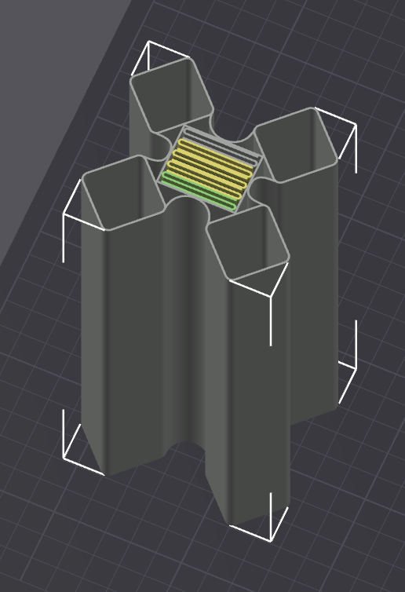
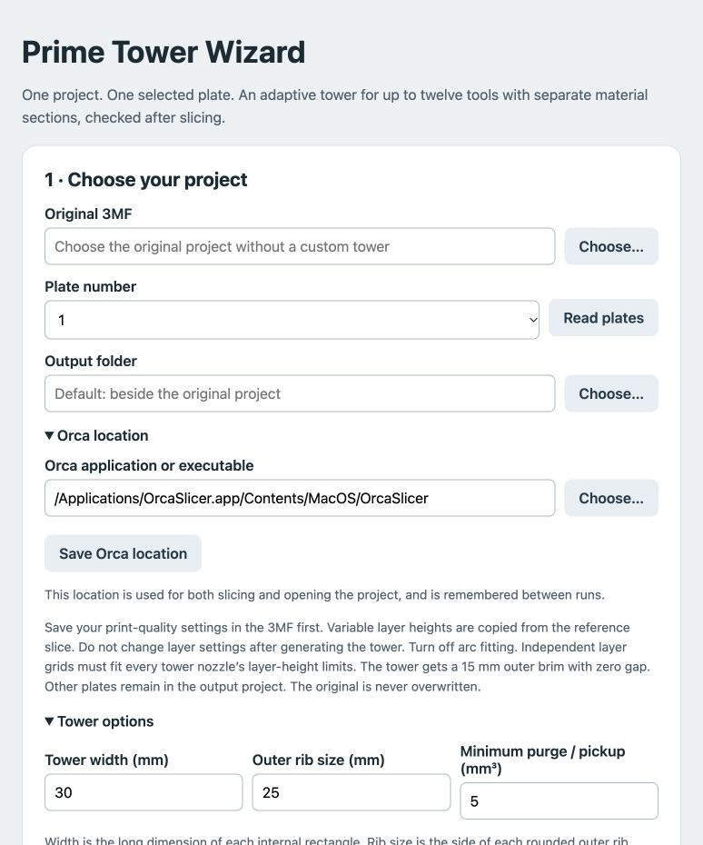

# Orca Prime Tower Wizard - for tool changers

Used to generate a custom prime tower that can be used in with multi-material prints instead of the slicer generated prime tower.  For instance PLA print with PETG supports.  Avoids difficulties of having mixed materials prime cleanly by preventing them from priming over the top of each other.

Takes an existing 3mf as input and generates a custom prime tower that exactly matches the filaments used to print the objects/supports on the plate. 

Creates dedicated sections within the tower for different filament types, ensuring that PLA is not priming on top of PETG, and vice versa.  Works with printed objects having more than 2 filament types.  Keeps the priming sections for the different filament types separate from each other.

Allows for basic configuration of tower width, rib size, minimum purge, and choice of which filament type to use for ribs and outer tower structure.

Optimizes tower to only include purge areas for filaments used for printed objects. Currently maxes out at 12 individual filaments. 

If particular filament is not used within a particular layer, it will substitute a like filament to keep the prime tower uniform.

Work flow is to input the source 3mf and make some basic tower generation selections.  Wizard will use local copy of ORCA to generate gcode which is analyzed to produce the prime tower, after which a newly generated 3mf (containing the tower) is opened in Orca.  Move the generated tower to where you want it located on the plate, slice and print.

Prime Tower Wizard assumes that the object heights, layer height (or variable layer heights) are already setup prior to running it as the tower is generated to match.  If they need to change, discard the 3mf generated by the wizard, adjust these settings and re-run the wizard.



**The generated tower:** Each filament has an internal priming section, with different material types kept separate vertically. The outer wall and rounded ribs support the structure. This example shows the tower in OrcaSlicer, where you can review and adjust its placement before the final slice.



**The wizard:** Select your original 3MF and plate, choose an output folder, and configure tower dimensions and minimum priming volume. The wizard generates the tower project for review in Orca and provides checks for the exported G-code. The screenshot shows the upper portion of the interface.

## Applications

| Application | Version | Purpose |
| --- | --- | --- |
| [Prime Tower Wizard](apps/isolated-prime-tower-v1.3.1/) | 1.3.1 | Generate the tower project, open it in Orca, and audit exported G-code. |
| [Tower Speed Ramp](apps/tower-speed-ramp-v1.0.1/) | 1.0.1 | Optional Orca post-processing script that gradually increases extrusion speed while priming after tool pickup. |

The applications are independent. The wizard works without the ramping script.

## Requirements

- Python 3.10 or later; no third-party Python packages required.
- OrcaSlicer, with a configured multi-toolhead printer. The development baseline is OrcaSlicer 2.4.2.
- Direct tool-to-filament mapping: T0 = slot 1 through T11 = slot 12.
- Plain G-code with Orca feature comments and arc fitting disabled.

The Python tools and launchers target macOS, Windows, and Linux. macOS has dedicated installers; cross-platform operation and printer-specific behavior still need validation on the intended system. The wizard accepts a custom Orca executable location.

## Installation

### 1. Create an installation folder and download the tools.

**macOS / Linux:**

```sh
cd "/full/path/to/installation folder"
git clone https://github.com/FwozenTone/prime-tower-wizard.git
cd prime-tower-wizard
```

**Windows PowerShell:**

```powershell
Set-Location -LiteralPath "C:\path\to\installation folder"
git clone https://github.com/FwozenTone/prime-tower-wizard.git
Set-Location prime-tower-wizard
```

### 2. Install or launch the tools

#### macOS

1. Start the installer from the same Terminal window:

   ```sh
   open "apps/isolated-prime-tower-v1.3.1/Install Prime Tower Wizard.command"
   ```

   Alternatively, open the downloaded folder in Finder and double-click that file.
2. The installer asks in Terminal where to install. Enter a parent folder, or press Return for `~/Applications`. It creates `Tower_Companion_v1.3.1` inside that folder, creates the application and Dock shortcut, and opens it.
3. Optionally run `apps/tower-speed-ramp-v1.0.1/Install Tower Speed Ramp.command`. It also asks for a parent folder, creates `Tower_Speed_Ramp_v1.0.1` inside it, and prints a setup command using your chosen location.

Enter `q` at either installation prompt to cancel. Paths containing spaces are supported. Earlier version folders remain available for rollback.

Close any older wizard session before launching the installed version.

#### Windows and Linux

Keep the application folders in a permanent location. On Windows, use `Start Prime Tower Wizard.bat` inside the wizard folder. On Linux, run `sh start-prime-tower-wizard.sh`, or start the wizard directly:

```sh
python3 apps/isolated-prime-tower-v1.3.1/tower_wizard.py
```

For ramping, use the full path to your Python executable and the post-processing script as described below.

## Workflow

1. Configure and save the original project in Orca, including materials, supports and layer heights.
2. In the wizard, select the original 3MF, plate number and Orca executable. Set tower width, rib size, minimum priming volume and material options.
3. Use the automatic slice/build/verify workflow, or the guided manual export workflow if command-line slicing is unavailable.
4. Open the generated tower project in Orca. Review the plate and move the entire `IPT_ASSEMBLY` in XY if needed. Save the project, keeping its matching `.3mf.ipt.json` sidecar beside it.
5. Slice and inspect Orca’s preview. Export G-code and audit the final export against the saved tower project. A previous audit does not cover later placement or slicing changes.

Regenerate after changing model geometry, materials or layer heights. Do not split, rotate, scale or rename the tower assembly. Retain **By layer**, **As object list**, tower-first ordering and the disabled built-in prime tower.

## Tower behavior

- One continuous internal priming section per actually used filament, up to 12 tools.
- Separate material types stay in separate vertical sections. An active tool of the same material type can maintain an idle tool’s section to reduce swaps.
- Rounded external ribs, an outer frame, and a requested 15 mm zero-gap outer brim.
- Configurable width, rib size and minimum priming volume; defaults are 30 mm, 25 mm and 5 mm³.
- Automatic rigid frame-material selection with a manual override. The preference is a heuristic, not a measured strength guarantee.
- Tower height ends at the last relevant reference pickup layer. Variable layer boundaries follow the reference print when compatible with the configured tools.
- The audit checks tower visits after tool changes, material confinement, layer coverage and priming volume. It cannot inspect motion hidden inside firmware macros or certify physical collision clearance.

## Optional volume-based ramping

In the generated tower project, configure **Process > Others > Post Processing Scripts** with the following as the **last** script. Replace all paths with absolute paths on your computer:

```text
"/absolute/path/to/python3" "/absolute/path/to/tower-speed-ramp-v1.0.1/orca_tower_ramp.py" --project "/absolute/path/to/saved-tower.3mf" --start-percent 25 --volume 5
```

Orca appends the G-code filename. Do not add one yourself. On Windows, use the full path to `python.exe`.

The script starts tower extrusion at 25% of the sliced speed and ramps toward 100% over 5 mm³ of deposited filament after each changed tool selection. Both values are adjustable. Set the tower’s minimum priming volume at least as high as the requested ramp volume. It preserves path ordering and restores sliced feed rates outside modified tower moves.

The script audits before and after modification, replaces the working export only after success, and rejects repeat application. Save the project after moving the tower and update `--project` for each job. Configure the hook only in the generated tower project, not in the original reference project or a shared preset used for reference slicing.

For the Voron workflow, ramping applies at export/send; normal slicer preview retains the original speeds. Inspect the exported plain G-code to see modified speeds. Time estimates are not recalculated.

See the [wizard guide](apps/isolated-prime-tower-v1.3.1/README.md) and [ramping guide](apps/tower-speed-ramp-v1.0.1/README.md) for detailed usage and limitations. The versioned guides are preserved snapshots and include historical validation notes.

## Version preservation and rollback

Wizard v1.3.1 and Speed Ramp v1.0.1 add installation-folder prompts. Their application runtime code is unchanged from v1.3 and v1.0. Those earlier folders remain archived snapshots; use the current versions above for new installations.

The versioned application folders are complete snapshots. Before any application changes, copy its entire folder into a new version directory and edit only that copy. Version the two applications independently; never overwrite an earlier complete version.

To roll back, launch or install the required earlier wizard. For ramping, update Orca’s post-processing command to point to the required earlier script, or remove the hook to disable ramping. Keep the matching generated project and sidecar together.

Wizard v1.3 runtime files, UI, tests and icons were compared byte for byte with the supplied working backup. Only its installer and guide were adjusted for the versioned destination and obsolete integrated-ramping file backup.

## Tests

From the repository root:

```sh
python3 -m unittest discover -s apps/isolated-prime-tower-v1.3.1 -p 'test_*.py'
python3 -m unittest discover -s apps/tower-speed-ramp-v1.0.1 -p 'test_*.py'
```

Synthetic tests do not replace reviewing the final slice or testing the export hook and physical print on the target machine. The separate ramping utility still requires end-to-end GUI export/send and hardware validation.
